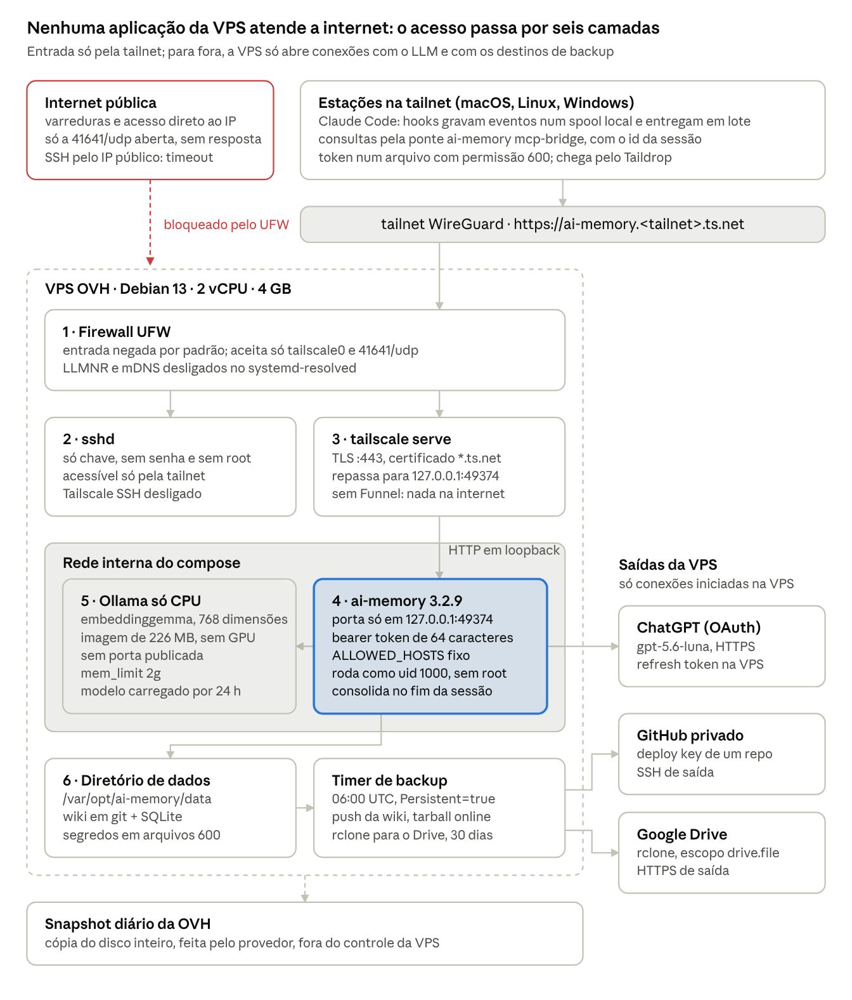
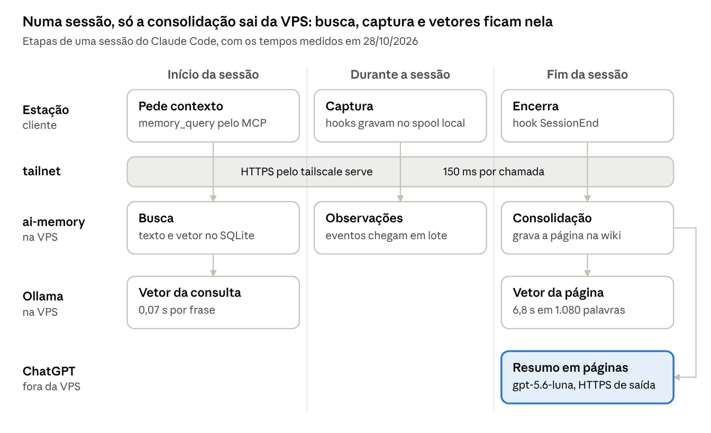
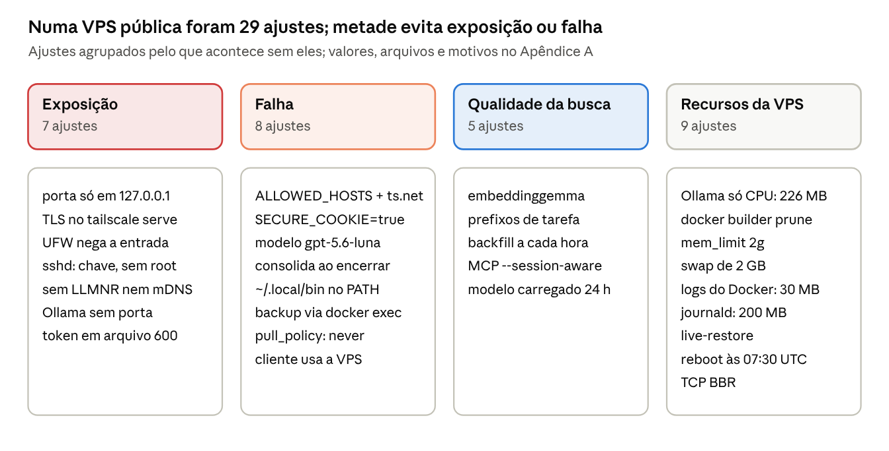
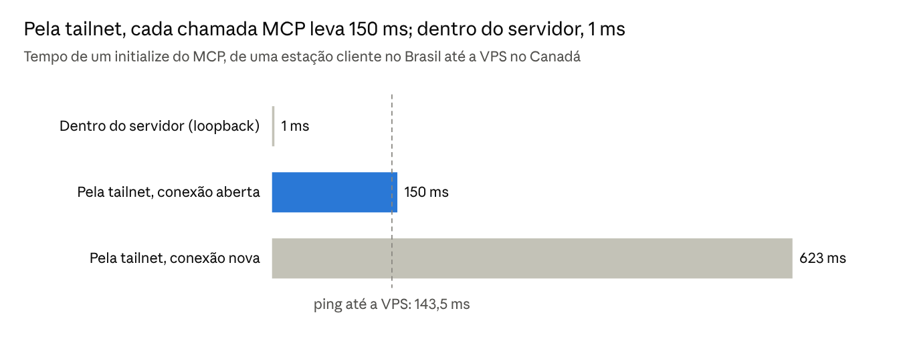
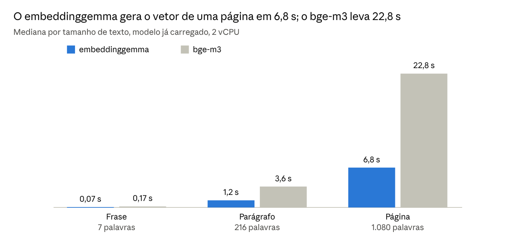
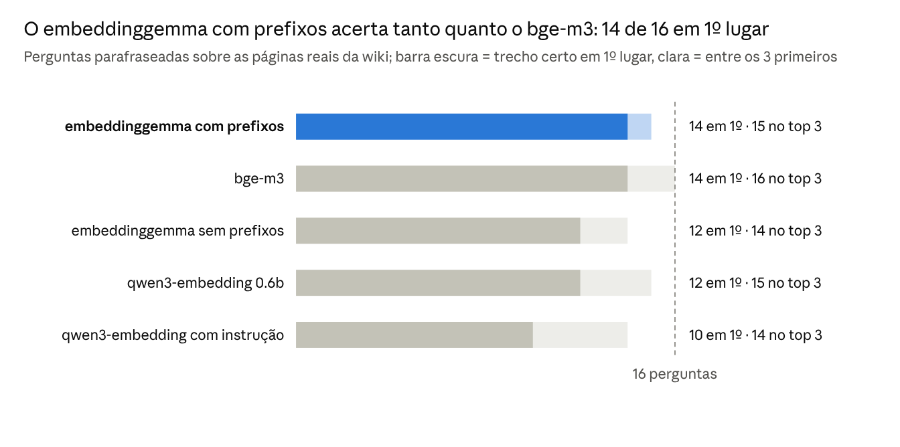
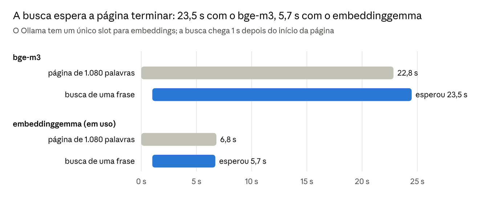
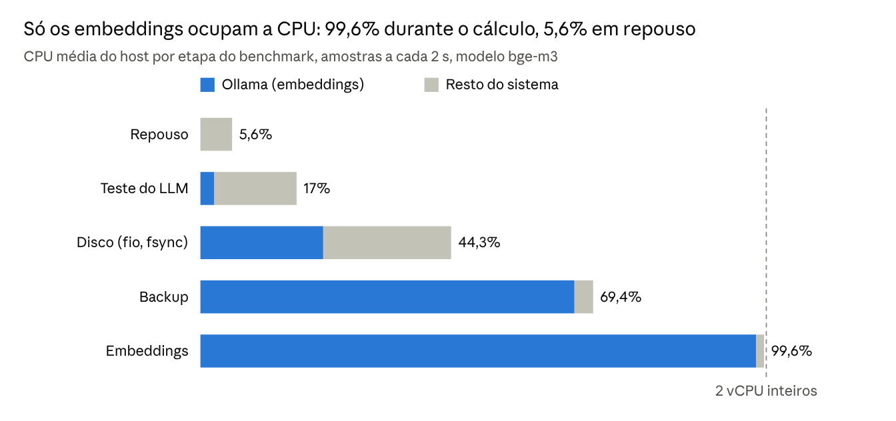

# Rodando o ai-memory numa VPS de US$ 5: arquitetura, benchmarks e gargalos reais

Thiago Rodrigues · 28/10/2026

## Resumo

**Objetivo.** Rodar o servidor de memória dos agentes de código numa VPS barata, sem porta de aplicação ou de administração aberta para a internet, e medir se ele aguenta o uso diário.

**Método.** Instalei o ai-memory 3.2.9 em Docker numa VPS-1 da OVHcloud (2 vCPU, 4 GB de RAM, US$ 5,35 ao mês), acessível só pela tailnet do Tailscale. Medi latência, CPU, memória, disco, qualidade de busca e backup em 28/10/2026, com o servidor em uso normal.

**Resultados.** Uma chamada MCP pela tailnet leva 150 ms e uma busca leva 104 ms. Gerar o vetor de uma página de 1.080 palavras leva 6,8 s. A CPU fica em 5,6% em repouso, a RAM em 1,3 GB e o backup completo termina em 39 s. Nas 16 perguntas do teste, o `embeddinggemma` pôs o trecho certo em 1º lugar 14 vezes, o mesmo que o `bge-m3`, e gera os vetores 3,4x mais rápido.

**Conclusão.** A VPS dá conta do meu uso diário depois de 29 ajustes. A configuração padrão do projeto foi pensada para rede local, e mais da metade dos ajustes existe para o servidor não ficar exposto ou para ele funcionar. A espera que aparece no dia a dia é a da busca atrás dos embeddings, que o Ollama gera um por vez e, em CPU, devagar.

## 1. Uma memória só, fechada para a internet

Sou arquiteto de cloud, não desenvolvedor em tempo integral, e uso o Claude em vários computadores. Sem uma memória compartilhada, cada máquina tinha o seu Claude, e nenhum deles sabia o que eu tinha decidido com os outros. A cada troca de computador eu explicava a mesma arquitetura de novo, como numa reunião com um colega que nunca leu a ata da anterior.

Esse perfil define o tamanho do problema. O volume é o de quem usa o Claude no trabalho de arquitetura, não o de quem deixa agentes rodando em paralelo a madrugada inteira, e é para esse uso que os números deste texto valem. A VPS de US$ 5,35 atende, e a fila do Ollama, o gargalo medido na seção 6.3, deve pesar menos aqui do que pesaria num time de desenvolvimento gravando páginas o tempo todo.

O [ai-memory](https://github.com/akitaonrails/ai-memory), projeto open source do Fabio Akita \[1\], centraliza essa memória num servidor: hooks capturam as sessões do Claude Code, Codex ou Cursor, e o agente consulta o histórico pelo protocolo MCP. As páginas consolidadas ficam numa wiki em markdown versionada em git. O SQLite guarda os índices de busca textual e vetorial e também dados que a wiki não reconstrói, como sessões, observações e handoffs.

Esse servidor guarda prompts, trechos de código e decisões de projeto, então não pode atender a internet. Parti de quatro requisitos:

- custo de uma VPS pequena, sem GPU;
- nenhuma porta de aplicação ou de administração respondendo fora de uma rede privada;
- consolidação das sessões sem pagar API por token;
- uma cópia completa dos dados fora do provedor da VPS.

## 2. Arquitetura: nenhuma porta de aplicação aceita conexão da internet



*Figura 1. Arquitetura e camadas de defesa · entrada só pela tailnet, saídas iniciadas pela VPS*

A entrada é só pela tailnet, a rede WireGuard do Tailscale. Para fora, a VPS só inicia conexões: com o ChatGPT, que resume as sessões, e com os destinos de backup (Figura 1). Um acesso vindo da internet para na primeira camada. Um dispositivo da tailnet sem o token para na quarta.

**Tabela 1.** Camadas de defesa e a configuração de cada uma

| Camada | O que barra | Configuração |
| --- | --- | --- |
| 1. Firewall UFW | conexão de entrada que não venha da tailnet | entrada negada; liberados só `tailscale0` e 41641/udp |
| 2. sshd | senha, root e SSH pelo IP público | só chave; porta 22 alcançável só pela tailnet |
| 3. `tailscale serve` | texto puro e publicação na internet | TLS com certificado `*.ts.net`; Funnel desligado |
| 4. ai-memory | requisição sem token ou com outro host | porta em `127.0.0.1`, bearer token de 64 caracteres, `AI_MEMORY_ALLOWED_HOSTS` |
| 5. Ollama | acesso direto ao modelo de embeddings | sem porta publicada; só a rede do compose chega nele |
| 6. Diretório de dados | leitura por outros usuários do sistema | dono uid 1000; token, OAuth e `.env.production` com permissão 600 |

**Tabela 2.** Conexões que a VPS inicia

| Destino | Para quê | Credencial na VPS | Alcance da credencial |
| --- | --- | --- | --- |
| Backend do ChatGPT (HTTPS) | consolidar sessões | refresh token OAuth | a assinatura Plus de uma conta |
| GitHub (SSH) | espelho git da wiki | deploy key ed25519 | escrita em um repositório privado |
| Google Drive (HTTPS) | cópia dos tarballs | token do rclone | escopo `drive.file`: só o que o rclone criou |
| Coordenação do Tailscale | manter a tailnet | chave do nó | este nó |
| Debian e Docker Hub (HTTPS) | patches e imagens | nenhuma | conteúdo público |

### O Tailscale no lugar do proxy e do certificado

Coloquei a VPS na tailnet com o hostname `ai-memory`, e o servidor responde em `https://ai-memory.<tailnet>.ts.net`. Os clientes fecham conexão direta pelo IP público na porta 41641/udp, sem relay DERP. Essa é a única entrada aberta para a internet, e não leva a nenhuma aplicação: o WireGuard descarta, sem resposta, todo pacote que não venha de um nó autenticado.

O HTTPS sai de um comando \[2\]:

```
tailscale serve --bg --https=443 http://127.0.0.1:49374
```

O Tailscale emite o certificado `*.ts.net`, termina o TLS e repassa para o ai-memory em loopback. Deixei Caddy, nginx e Let's Encrypt de fora. Deixei o Tailscale SSH desligado, porque o modo `check` pede reautenticação no navegador e trava sessões automatizadas. O Funnel também, porque publicaria o servidor na internet.

> **Armadilha.** As portas que o Docker publica entram no iptables antes das regras do UFW \[3\]. Uma porta publicada em `0.0.0.0` fica aberta na internet com o UFW negando tudo, e o `ufw status` não mostra isso. Por isso publiquei o ai-memory só em `127.0.0.1:49374`, e o Ollama não publica porta nenhuma.

Se o Tailscale cair na VPS, o acesso de emergência é o console KVM do painel da OVH.

## 3. O caminho de uma sessão



*Figura 2. Ciclo de uma sessão do Claude Code · tempos medidos em 28/10/2026*

No início da sessão, o Claude pede contexto pela ponte MCP, e o ai-memory busca no SQLite com o vetor da consulta que o Ollama gera. Durante a sessão, os hooks gravam cada prompt e tool call num spool local e entregam em lote no fim de cada resposta. Se o servidor estiver fora do ar, a captura espera no spool e `ai-memory recover` reenvia depois.

No fim, o ai-memory manda o texto da sessão ao ChatGPT, recebe o resumo em páginas, grava na wiki e pede ao Ollama o vetor de cada página (Figura 2). O texto da sessão sai da VPS nesse momento e nos backups. Busca, captura e vetores ficam nela.

## 4. O que precisa mudar para rodar numa VPS pública: 29 ajustes



*Figura 3. Os 29 ajustes para rodar numa VPS pública, agrupados pelo efeito de não fazê-los*

O exemplo de produção do ai-memory publica a porta em `0.0.0.0` para a rede local alcançar o servidor, e o comentário no arquivo diz que, atrás do firewall de casa, isso basta. Numa VPS com IP público, os mesmos valores deixam o servidor exposto, sem consolidar sessões na minha conta Plus e com busca fraca em português. Agrupei os ajustes pelo que acontece sem eles (Figura 3). Cinco pesam mais:

- **Porta em loopback.** O `docker-compose.prod.yml.example` publica em `0.0.0.0:49374`. Numa VPS com IP público, isso abre a porta para a internet, mesmo com o UFW negando a entrada.
- **`AI_MEMORY_ALLOWED_HOSTS`.** O padrão aceita só `localhost`, `127.0.0.1` e `::1`. Sem o nome `ai-memory.<tailnet>.ts.net` na lista, o servidor recusa tudo que chega pelo `serve`.
- **Modelo do LLM fixado.** A documentação do projeto recomenda manter o padrão do provider `openai-oauth`, o `gpt-5.5`. Na minha conta Plus, em 28/10/2026, o `ai-memory llm-test --provider openai-oauth` recebeu `400 model_not_found` com a mensagem "The 'gpt-5.5' model is not supported when using Codex with a ChatGPT account". O `gpt-5.6` e o `gpt-5.5-codex` tiveram a mesma resposta, e o `gpt-5.6-luna` respondeu. Outra conta pode aceitar outro conjunto de modelos.
- **Embedder multilíngue.** O embutido, `all-MiniLM-L6-v2`, foi treinado só em inglês. O `embeddinggemma` roda num Ollama ao lado, com os prefixos de tarefa do model card \[4\].
- **Ollama só para CPU.** A imagem oficial tem 8,43 GB, dos quais 4,3 GB são CUDA, MLX e Vulkan. Uma imagem gerada na própria VPS a partir da oficial tem 226 MB.

O Apêndice A traz o valor padrão, o valor em uso e o efeito de cada um dos 29 ajustes, além do `docker-compose.yml`, do `.env.production` sem os segredos e do Dockerfile do Ollama.

## 5. Como medi

**Tabela 3.** Servidor usado nos testes

| Recurso | Valor |
| --- | --- |
| Plano | VPS-1 da OVHcloud em Beauharnois (Canadá), US$ 5,35 ao mês \[6\] |
| CPU | 2 vCPU Intel Haswell em KVM, com AVX2 |
| Memória | 4 GB (3,7 GB utilizáveis) e swap de 2 GB |
| Disco | 40 GB NVMe local |
| Rede | 500 Mbps, sem cobrança por tráfego na região |
| Sistema | Debian 13 (trixie), kernel 6.12 cloud, Docker, Ollama 0.40.10 |

Fiz as medições em 28/10/2026, com o servidor em uso normal. Um coletor gravou CPU, memória e o consumo de cada container a cada 2 segundos durante todas as etapas. Medi a latência com `curl` numa estação cliente no Brasil, 30 chamadas por caminho. Já as operações do ai-memory eu medi no loopback da VPS, 6 chamadas MCP por operação, com o Ollama livre e com o Ollama gerando embeddings de páginas longas sem parar.

Para a qualidade da busca, usei 16 perguntas parafraseadas, duas em inglês, sobre 25 trechos das páginas reais da wiki e do README. Cada modelo indexou os 25 trechos, e o teste contou quantas vezes o trecho certo apareceu em 1º lugar e entre os 3 primeiros. As saídas brutas estão no Apêndice B, e os scripts e as perguntas, no Apêndice C.

## 6. Resultados

### 6.1 Latência: 150 ms, quase tudo distância



*Figura 4. Latência do MCP · curl numa estação cliente, 30 chamadas por caminho, 28/10/2026*

O ping até Beauharnois é de 143,5 ms, e o ai-memory responde em 1 ms (Figura 4). Uma conexão nova custa 623 ms porque soma o TCP (161 ms), o TLS (concluído aos 327 ms) e a resposta (primeiro byte aos 475 ms). A ponte MCP mantém a conexão aberta, então o custo do dia a dia é o de 150 ms. Os hooks ficam fora dessa conta, porque entregam em segundo plano.

### 6.2 Embeddings: mesmo acerto em 1º lugar, um terço do tempo



*Figura 5. Tempo de embedding por tamanho de texto · medido na VPS, 10 chamadas por tamanho (5 na página), Ollama 0.40.10 em CPU*



*Figura 6. Qualidade da busca · 16 perguntas sobre 25 trechos da wiki, model_bench.out*

O `embeddinggemma` gera o vetor de uma página 3,4x mais rápido que o `bge-m3` (Figura 5) e pôs o trecho certo em 1º lugar nas mesmas 14 de 16 perguntas (Figura 6). Entre os 3 primeiros, o `bge-m3` acertou 16 e o `embeddinggemma` 15, e o MRR ficou em 0,938 contra 0,905. Com 16 perguntas, cada acerto vale 6,25 pontos percentuais: o teste mostra que o modelo menor serve nesta VPS, mas não prova que os dois têm a mesma qualidade. Ele também mede só o embedding. A busca do ai-memory combina o vetor com busca textual, entidades e links entre páginas, e esse conjunto eu não medi. Com acerto parecido, o que decide é o custo de CPU e memória:

**Tabela 4.** Tamanho dos modelos comparados

| Modelo | Parâmetros | Dimensões | Memória residente |
| --- | --- | --- | --- |
| `embeddinggemma` (em uso) | 308M | 768 | 681 MiB |
| `bge-m3` | 568M | 1.024 | 1.250 MiB |
| `qwen3-embedding:0.6b` | 595M | 1.024 | 1.122 MiB |

Os prefixos de tarefa valem duas respostas certas a mais para o `embeddinggemma`. No Qwen3, a instrução de consulta piorou o resultado.

### 6.3 A busca espera na fila do Ollama



*Figura 7. Fila do Ollama · busca enviada 1 s depois de uma página longa, model_bench.out*

A espera tem duas causas que se somam. O Ollama processa embeddings com um único slot, e em CPU uma página longa ocupa esse slot por segundos. A variável `OLLAMA_NUM_PARALLEL` não vale para esse tipo de modelo, e o log do runner mostra `n_slots = 1` com qualquer valor. Uma busca que chega enquanto uma página está sendo processada espera essa página terminar (Figura 7).

**Tabela 5.** Operações do ai-memory com o Ollama livre e ocupado (mediana de 6 chamadas)

| Operação | `bge-m3` livre | `bge-m3` ocupado | `embeddinggemma` livre | `embeddinggemma` ocupado |
| --- | --- | --- | --- | --- |
| `memory_query` | 159 ms | 23,9 s | 104 ms | 6,5 s |
| `memory_recent` | 2,3 ms | 3,4 ms | 3,0 ms | 4,6 ms |
| `memory_read_page` | 2,7 ms | 2,8 ms | 2,9 ms | 4,8 ms |

Só a busca sente a fila, porque é a única operação da tabela que precisa de um vetor. Listar e ler páginas continua na casa dos milissegundos com a CPU em 100%. O caso típico de espera é fechar uma sessão e abrir outra logo em seguida: a página da sessão anterior ainda está no Ollama quando a nova pede contexto.

> **Agendar os embeddings não resolve.** O ai-memory gera o vetor logo depois de gravar a página, e a busca precisa do modelo na hora. O que reduz a espera é um modelo mais rápido.



*Figura 8. CPU por etapa dos testes · /proc/stat e docker stats a cada 2 s, medido com o bge-m3*

A CPU só satura enquanto o Ollama calcula embeddings; em repouso, o sistema usa 5,6% (Figura 8). O teste do LLM chega a 17%, quase tudo do `docker exec` que dispara o teste, porque o modelo roda nos servidores da OpenAI. Fiz a medição por etapa com o `bge-m3`. Com o `embeddinggemma`, os picos têm a mesma forma e duram cerca de um terço.

Durante um embedding longo, o initialize do MCP no loopback ficou em 1,4 ms no p50 e 5,5 ms no p95, contra 1,2 ms e 1,4 ms em repouso. Limitar o Ollama a 1 vCPU só deixaria o embedding mais lento: com o `bge-m3`, um texto de 216 palavras passa de 3,3 s para 6,3 s.

### 6.4 Memória, disco e a VPS

A memória ficou estável em todas as etapas, sem uso de swap. Com o `embeddinggemma` carregado, a VPS usa 1,3 GB dos 3,7 GB, e o cache de páginas do kernel ocupa outros 1,3 GB, liberados sob demanda.

**Tabela 6.** Memória residente por processo

| Processo | Memória |
| --- | --- |
| `llama-server` (`embeddinggemma`, dentro do Ollama) | 722 MiB |
| `dockerd` | 130 MiB |
| `containerd` | 66 MiB |
| `tailscaled` | 54 MiB |
| `ai-memory` | 45 MiB |
| `ollama` (processo servidor) | 40 MiB |

O disco tem 6,1 GB em uso dos 40 GB, dos quais 1,7 GB são modelos do Ollama. As duas imagens Docker somam 424 MB.

**Tabela 7.** Desempenho da VPS

| Medida | Resultado |
| --- | --- |
| sysbench cpu, 1 thread | 310 eventos/s, p95 de 3,55 ms |
| CPU steal com os 2 vCPUs em 100% | 0,02% |
| `bge-m3` com 1, 1,5 e 2 vCPU (216 palavras) | 6,3 s, 4,4 s e 3,3 s |
| Memória, blocos de 1 KB, 1 thread | 4.087 MiB/s |
| Memória, blocos de 1 MB, 2 threads | 13.248 MiB/s |
| Disco, escrita 4 KB com fsync a cada escrita | 1.598 IOPS; fsync médio de 0,61 ms, p99 de 0,91 ms |
| Disco, leitura sequencial 1 MB | 561 MiB/s |
| Disco, leitura aleatória 4 KB, fila 32 | 27.607 IOPS |
| Download da internet (100 MB da OVH) | 54 MB/s (435 Mbps) |
| Cópia por ssh na tailnet | 9,9 MB/s de download, 6,0 MB/s de upload |

Com steal de 0,02% sob carga total, os vCPUs não disputaram o host com outras VMs no período medido. O tempo do `bge-m3` cai quase em proporção aos vCPUs, então o segundo núcleo rende. Com fsync médio de 0,61 ms, cada commit do SQLite custa menos de 1 ms de disco. Pela tailnet, a cópia por ssh fica em 9,9 MB/s numa única conexão TCP, com RTT de 143 ms. O teste não isolou o que limita essa taxa.

## 7. Backup: o Drive é a única cópia completa fora da OVH

**Tabela 8.** O que cada cópia restaura em quatro falhas

| Falha | GitHub (espelho git) | Tarball (na própria VPS) | Google Drive (tarballs, 30 dias) | Snapshot (da OVH, diário) |
| --- | --- | --- | --- | --- |
| Página apagada por engano | pelo histórico | completo | completo | completo |
| Banco SQLite corrompido | só a wiki | completo | completo | completo |
| VPS perdida | só a wiki | perdido | completo | completo |
| Conta da OVH perdida | só a wiki | perdido | completo | perdido |

"Completo" devolve wiki, sessões, observações, handoffs e tokens com `ai-memory restore`. "Só a wiki" devolve as páginas com `ai-memory reindex`, e sessões e tokens se perdem. Só o Drive guarda uma cópia completa dos dados fora da OVH. Nenhuma das cópias, exceto o snapshot, traz a instalação em si: o `.env.production` com o token do servidor, o `auth.json` do ChatGPT, a deploy key do GitHub e o token do rclone ficam fora dos tarballs e do espelho, e numa VPS nova precisam ser refeitos. Também não testei o restore numa máquina limpa: o backup roda todo dia, mas a volta ainda não foi validada.

Um timer do systemd roda o script de backup todo dia às 06:00 UTC, com até 30 minutos de variação e `Persistent=true`: se a VPS estiver desligada no horário, o backup roda quando ela voltar. Uma execução completa leva 39 s, e o tarball do dia tem 305 KB.

**Tabela 9.** Camadas de backup

| Camada | Destino | Conteúdo | Retenção |
| --- | --- | --- | --- |
| Espelho git | repositório privado no GitHub | wiki, `docker-compose.yml` e Dockerfile do Ollama | histórico do git |
| Tarball local | `/var/opt/ai-memory/tarballs` | wiki e snapshot consistente do SQLite | 30 dias |
| Cópia externa | pasta no Google Drive | os mesmos tarballs | 30 dias |
| Snapshot | painel da OVH | disco inteiro da VPS | diário, do provedor |

Sessões, observações, handoffs e tokens existem só no SQLite. Por isso o espelho git, sozinho, só devolve a wiki (Tabela 8). O tarball sai de `ai-memory backup`, que copia o SQLite pela API de backup online; uma cópia direta do arquivo poderia pegar o WAL no meio de uma escrita.

Antes do push, o `rsync` exclui do espelho `auth.json`, `auth-tokens/`, `db/` e arquivos `*.env`, `*.pem`, `*.key` e `*.crt`. Uma busca pelo token do servidor no espelho não encontra nenhuma ocorrência. O rclone usa o escopo `drive.file`, que só enxerga os arquivos que ele mesmo criou.

Os tarballs vão ao Drive sem criptografia. Foi uma escolha minha, consciente, e aceitei o risco: quem tiver acesso à conta Google, ou a um link compartilhado desses arquivos, lê as sessões capturadas. O escopo `drive.file` limita o que o rclone enxerga, não quem lê a conta. O ideal é criptografar antes do envio, com um remote `crypt` do rclone, e guardar a senha fora da VPS e da conta Google, porque sem ela o backup não volta.

## 8. Como fica o uso no dia a dia

No uso normal não há comando a rodar. Os hooks capturam as sessões, e o Claude consulta a memória quando o pedido precisa de contexto:

**Tabela 10.** Pedidos comuns e a ferramenta MCP que atende cada um

| Pedido ao agente | Ferramenta MCP |
| --- | --- |
| "já discutimos X?", "o que decidimos sobre Y?" | `memory_query` |
| "onde paramos?" | handoff / `memory_explore` |
| "lembre que aqui usamos pnpm" | `memory_write_page` |
| "em todos os meus projetos: nunca dar force-push" | `memory_write_page` com `scope: "global"` |
| "encerra e salva o contexto" | `memory_handoff_begin` |

Dois hábitos melhoram o resultado. `ai-memory install-instructions`, rodado uma vez por projeto, grava no `CLAUDE.md` as regras de quando consultar a memória. Abrir o agente com `ai-memory run claude` acrescenta handoff entre sessões e `ai-memory continue` para retomar trabalho. A interface web fica em `https://ai-memory.<tailnet>.ts.net/web`, com o token como senha.

## 9. Riscos e limitações

**Tabela 11.** Riscos conhecidos

| Risco | O que quebra | Mitigação atual |
| --- | --- | --- |
| OpenAI bloquear o uso do backend do ChatGPT por terceiros | a consolidação; captura e busca continuam | trocar quatro linhas do `.env.production` para OpenRouter + Haiku |
| Cota do ChatGPT Plus esgotar num dia pesado | consolidação das sessões daquele dia | nenhuma automática |
| Tailscale cair na VPS | nenhum cliente alcança o servidor; a captura espera no spool | console KVM da OVH |
| Dispositivo da tailnet comprometido | acesso de rede ao servidor | o token continua exigido; o nó sai pelo painel da tailnet; a política da tailnet ainda libera tudo |
| Vazamento do Drive ou do GitHub | sessões capturadas legíveis | repositório privado e escopo `drive.file`; sem criptografia, risco aceito; o ideal é rclone crypt |
| Versão nova do ai-memory com migração | servidor e clientes fora de sincronia | versão fixada no compose; atualização com backup antes |
| VPS comprometida | acesso às estações pela tailnet e às credenciais guardadas na VPS | nenhuma na tailnet enquanto a política for a padrão; grants descritos abaixo |

O servidor só existe dentro da tailnet, então ambientes sem Tailscale, como o Claude Code na web ou runners de CI, ficam sem memória. O rclone da VPS é o pacote do Debian, versão 1.60, que funciona com o Drive hoje; se o Google mudar o fluxo de OAuth, a saída é o binário oficial. O SSH aceita só as chaves já cadastradas.

### O login do ChatGPT: três riscos diferentes

O provider `openai-oauth` entra na conta ChatGPT pelo backend do Codex e guarda o refresh token em `auth.json`, no diretório de dados da VPS. Esse arranjo tem três riscos que quebram coisas diferentes e pedem respostas diferentes.

**Tabela 12.** Riscos do login do ChatGPT

| Risco | O que acontece | Situação na minha instalação |
| --- | --- | --- |
| Compatibilidade do backend | a OpenAI muda o backend ou os modelos aceitos, e a consolidação falha; captura e busca continuam | já aconteceu com o `gpt-5.5` (seção 4); a troca para OpenRouter + Haiku muda quatro linhas do `.env.production` (Tabela A5) |
| Autorização de uso | o uso da assinatura por um servidor remoto pode não estar coberto pelas regras da OpenAI | sem resposta clara; detalhe abaixo |
| Credencial guardada na VPS | quem ler o `auth.json` usa a assinatura Plus em nome da conta até o token ser revogado | arquivo com permissão 600; fora do espelho git e dos tarballs, que levam só o banco e a wiki; dentro do snapshot da OVH |

A OpenAI documenta o uso do plano do ChatGPT por apps de terceiros na integração Sign in with ChatGPT \[7\]. Pelo guia, esse uso vale para projetos open source e projetos pessoais que rodam localmente, e um app hospedado remotamente precisa pedir acesso antes de ser oferecido a usuários. O ai-memory é open source e minha instalação é de uso pessoal, mas roda numa VPS e não na minha máquina, e o login do projeto passa pelo Codex, não por essa integração. O guia não cobre esse caso. Por isso trato a consolidação pelo ChatGPT como uma dependência que pode sumir: captura, busca e backup não dependem dela.

Se o `auth.json` vazar, a resposta é sair de todos os dispositivos nas configurações de segurança da conta ChatGPT, rodar `ai-memory auth logout openai-oauth` na VPS e refazer o login.

### Quem na tailnet alcança a VPS

A política de acesso da minha tailnet ainda é a padrão de uma tailnet nova: o filtro de pacotes que o Tailscale distribui libera todo dispositivo para todo dispositivo, em qualquer porta. O token do ai-memory continua exigido na 443, mas a regra vale nos dois sentidos. Se a VPS for comprometida, ela alcança as estações da casa pela tailnet, e é a máquina com mais credenciais guardadas: refresh token do ChatGPT, deploy key do GitHub e token do rclone.

Os grants do Tailscale negam tudo que não estiver liberado, e cada regra vale só de `src` para `dst` \[8\]. Com a VPS marcada com uma tag, a política abaixo deixa os dispositivos dos membros da tailnet conversarem entre si, libera só as portas 443 e 22 da VPS e não dá à VPS nenhuma regra de saída para a tailnet:

```json
{
  "tagOwners": {
    "tag:ai-memory": ["autogroup:admin"]
  },
  "grants": [
    {"src": ["autogroup:member"], "dst": ["autogroup:member"], "ip": ["*"]},
    {"src": ["autogroup:member"], "dst": ["tag:ai-memory"], "ip": ["tcp:443", "tcp:22"]}
  ]
}
```

Um dispositivo com tag deixa de pertencer a um usuário, então o Taildrop para de funcionar com a VPS, e o token passa a ir por `scp` na porta 22. A tag é aplicada no painel da tailnet, na máquina da VPS, e o editor do painel valida a política antes de salvar.

## 10. O que levar daqui

1. **Publique as portas do Docker só em `127.0.0.1`.** O UFW não protege o que o Docker publica.
2. **Deixe o TLS com o `tailscale serve`.** Um comando substitui proxy reverso e renovação de certificado.
3. **Teste o modelo do LLM antes de confiar na consolidação.** Rode `ai-memory llm-test` com a sua conta. Na minha conta Plus, o padrão `gpt-5.5` voltou 400 e o `gpt-5.6-luna` respondeu.
4. **Troque o embedder se as sessões forem em português.** Nas 16 perguntas, o `embeddinggemma` com prefixos acertou em 1º lugar tantas vezes quanto o `bge-m3`, com um terço do tempo e metade da memória.
5. **Monte o Ollama só para CPU.** A imagem oficial gasta 4,3 GB com GPU que a VPS não tem.
6. **Tenha uma cópia completa fora do provedor.** O espelho git devolve a wiki, mas não as sessões.
7. **Criptografe essa cópia.** Aceitei o risco de mandar os tarballs abertos ao Drive; um remote `crypt` do rclone fecha esse risco.

Próximos passos: aplicar os grants da seção 9 e marcar a VPS com `tag:ai-memory`, criptografar os tarballs com um remote `crypt` do rclone, rodar `ai-memory install-instructions` nos projetos ativos, ligar as demais estações da tailnet com o prompt do README e, depois de um mês, revisar a cota do ChatGPT Plus e o tamanho do banco.

## Referências

1. ai-memory, repositório oficial. https://github.com/akitaonrails/ai-memory
2. Tailscale. Tailscale Serve. https://tailscale.com/kb/1312/serve
3. Docker. Packet filtering and firewalls. https://docs.docker.com/engine/network/packet-filtering-firewalls/
4. Google. EmbeddingGemma model card. https://ai.google.dev/gemma/docs/embeddinggemma/model\_card
5. Ollama. embeddinggemma. https://ollama.com/library/embeddinggemma
6. OVHcloud. VPS. https://www.ovhcloud.com/en/vps/
7. OpenAI. Integrating Sign in with ChatGPT in your open-source app. https://developers.openai.com/cookbook/articles/sign-in-with-chatgpt
8. Tailscale. Grants. https://tailscale.com/kb/1324/grants

## Apêndice A. Configuração completa

Os valores padrão são os da versão 3.2.9 do ai-memory, que conferi no código-fonte, e os da imagem oficial do Ollama.

**Tabela A1.** Servidor ai-memory

| Item | Padrão | Na minha instalação | Sem o ajuste |
| --- | --- | --- | --- |
| Publicação da porta | `0.0.0.0:49374` no exemplo de produção, pensado para a LAN | `127.0.0.1:49374` | porta aberta na internet |
| TLS | nenhum | `tailscale serve` na 443 | bearer token em texto puro |
| `AI_MEMORY_ALLOWED_HOSTS` | `localhost`, `127.0.0.1`, `::1` | inclui `ai-memory.<tailnet>.ts.net` | requisições do `serve` recusadas |
| `AI_MEMORY_AUTH__SECURE_COOKIE` | `false` | `true` | com login na interface web, o servidor recusa subir em HTTP fora do loopback |
| `AI_MEMORY_LLM_MODEL` | `gpt-5.5` | `gpt-5.6-luna` | `400 model_not_found` na minha conta Plus, em 28/10/2026 |
| `AI_MEMORY_CONSOLIDATE_ON_SESSION_END` | `false` | `true` | sessões só viram páginas quando alguém pede |
| Backfill de embeddings | desligado com embedder configurado | a cada 3.600 s | página que falhou no embedding fica fora da busca |
| Embedder | `all-MiniLM-L6-v2`, só inglês | `embeddinggemma` pelo provider `openai-compat` | busca fraca em português |
| Prefixos de tarefa | nenhum | os do model card do Google | duas respostas certas a menos em 16 |

**Tabela A2.** Ollama

| Item | Padrão | Na minha instalação | Sem o ajuste |
| --- | --- | --- | --- |
| Imagem | `ollama/ollama`, 8,43 GB | `local/ollama-cpu:0.40.10`, 226 MB | 4,3 GB em bibliotecas de GPU |
| `pull_policy` | baixa quando falta | `never` | `docker compose pull` procura a imagem local no Docker Hub |
| Cache de build | fica no disco | `docker builder prune -af` | 8,4 GB de cache no disco |
| Memória | sem limite | `mem_limit: 2g` | pico do Ollama pode levar o OOM killer ao ai-memory |
| `OLLAMA_KEEP_ALIVE` | 5 minutos | 24 h | cerca de 3 s de carga na primeira busca depois de uma pausa |
| Porta | publicada nos exemplos de uso | nenhuma | modelo acessível fora do compose |

**Tabela A3.** Sistema operacional

| Área | Configuração | Arquivo | Sem o ajuste |
| --- | --- | --- | --- |
| SSH | sem senha, sem teclado interativo, sem root, só chave | `/etc/ssh/sshd_config.d/10-hardening.conf` | depende da imagem do provedor |
| Firewall | UFW negando entrada; `tailscale0` e 41641/udp liberados, IPv4 e IPv6 | regras do UFW | serviço em `0.0.0.0` fica na internet |
| Resolução de nomes | `LLMNR=no`, `MulticastDNS=no` | drop-in do `systemd-resolved` | porta 5355 aberta em `0.0.0.0` |
| Memória | swapfile de 2 GB, `vm.swappiness = 10` | `/etc/sysctl.d/90-ai-memory.conf` | OOM killer num pico |
| Rede | BBR com `fq` | `/etc/sysctl.d/90-ai-memory.conf` | controle de congestionamento que rende menos com 143 ms de RTT |
| Logs do Docker | driver `local`, 3 arquivos de 10 MB | `/etc/docker/daemon.json` | `json-file` cresce sem limite |
| Docker | `live-restore: true` | `/etc/docker/daemon.json` | containers param quando o `dockerd` reinicia |
| Journal | `SystemMaxUse=200M` | `/etc/systemd/journald.conf.d/size.conf` | até 10% do disco em logs |
| Atualizações | reboot automático às 07:30 UTC, depois do backup | `/etc/apt/apt.conf.d/52ai-memory-reboot` | kernel corrigido instalado sem uso |

**Tabela A4.** Clientes e backup

| Item | Padrão | Na minha instalação | Sem o ajuste |
| --- | --- | --- | --- |
| Cliente | `ai-memory setup` sobe um servidor local | só o binário, com `server_url` apontando para a VPS | uma memória separada por máquina |
| MCP | sem `--session-aware` | `install-mcp --session-aware`, pela ponte `mcp-bridge` | consultas sem o id da sessão |
| `PATH` | `~/.local/bin` fora do `PATH` em alguns shells | incluído no shell que abre o Claude Code | hooks não acham o binário e nada é capturado |
| Token | aceito no config do agente ou em variável de ambiente | arquivo 600, levado pelo Taildrop | segredo espalhado em configurações |
| Script de backup | exemplo para instalação nativa | adaptado para Docker, com exclusão de segredos | não acha o binário nem o banco |

No cliente, o instalador oficial confere o SHA-256 da release e cria `~/.local/bin/ai-memory`. A configuração fica no data dir do ai-memory (no macOS, `~/Library/Application Support/ai-memory`), e dois comandos ligam o Claude Code: `ai-memory install-mcp --client claude-code --session-aware --apply` e `ai-memory install-hooks --agent claude-code --apply`.

```
server_url = "https://ai-memory.<tailnet>.ts.net"

[auth]
bearer_token_file = "auth-tokens/default"
```

O `docker-compose.yml` em `/opt/ai-memory`:

```yaml
name: ai-memory
services:
  ai-memory:
    image: akitaonrails/ai-memory:3.2.9
    container_name: ai-memory
    restart: unless-stopped
    user: "1000:1000"
    ports:
      # Loopback only: exposed to the tailnet via "tailscale serve" (HTTPS).
      - "127.0.0.1:49374:49374"
    volumes:
      - /var/opt/ai-memory/data:/data
    env_file:
      - .env.production
    environment:
      - RUST_LOG=ai_memory=info,ai_memory_store=info,ai_memory_wiki=info,ai_memory_mcp=info,tracing_appender=warn
      # Multilingual embeddings (embeddinggemma) served by the ollama sidecar below.
      - AI_MEMORY_EMBEDDING_PROVIDER=openai-compat
      - AI_MEMORY_EMBEDDING_BASE_URL=http://ollama:11434/v1
      - AI_MEMORY_EMBEDDING_MODEL=embeddinggemma
      - AI_MEMORY_EMBEDDING_DIM=768
      # EmbeddingGemma task prompts (query / document), as recommended by Google.
      - "AI_MEMORY_EMBEDDING_QUERY_PREFIX=task: search result | query: "
      - "AI_MEMORY_EMBEDDING_DOCUMENT_PREFIX=title: none | text: "
    depends_on:
      - ollama
    healthcheck:
      test: ["CMD", "/usr/local/bin/ai-memory", "status"]
      interval: 30s
      timeout: 5s
      retries: 3
      start_period: 5s
  ollama:
    # Embeddings only; no published port, reachable just from the compose network.
    # CPU-only build of ollama/ollama (see ollama-cpu/Dockerfile).
    image: local/ollama-cpu:0.40.10
    pull_policy: never
    build:
      context: ./ollama-cpu
      args:
        OLLAMA_VERSION: "0.40.10"
    container_name: ai-memory-ollama
    restart: unless-stopped
    volumes:
      - /var/opt/ai-memory/ollama:/root/.ollama
    environment:
      - OLLAMA_KEEP_ALIVE=24h
    mem_limit: 2g
```

O `.env.production`, com permissão 600 e os segredos trocados por marcadores:

```
AI_MEMORY_AUTH_TOKEN=<64 caracteres hex, gerado com ai-memory generate-auth-token>
AI_MEMORY_ALLOWED_HOSTS=ai-memory.<tailnet>.ts.net,localhost,127.0.0.1,::1
AI_MEMORY_AUTH__SECURE_COOKIE=true
AI_MEMORY_LLM_PROVIDER=openai-oauth
AI_MEMORY_LLM_MODEL=gpt-5.6-luna
AI_MEMORY_CONSOLIDATE_ON_SESSION_END=true
AI_MEMORY_MAINTENANCE__EMBEDDING_BACKFILL_INTERVAL_SECS=3600
```

O Dockerfile do Ollama só para CPU, em `/opt/ai-memory/ollama-cpu`. Uma versão nova sai de `docker compose build ollama`, seguido de `docker builder prune -af`:

```dockerfile
# CPU-only Ollama: the upstream image ships ~4 GB of CUDA/Vulkan libraries
# this VPS has no GPU for. Same binary and CPU backends, on a plain base.
ARG OLLAMA_VERSION=0.40.10

FROM ollama/ollama:${OLLAMA_VERSION} AS full
RUN rm -rf /usr/lib/ollama/cuda_* /usr/lib/ollama/mlx_* /usr/lib/ollama/vulkan /usr/lib/ollama/include

FROM ubuntu:24.04
RUN apt-get update && apt-get install -y --no-install-recommends ca-certificates \
    && rm -rf /var/lib/apt/lists/*
COPY --from=full /usr/bin/ollama /usr/bin/ollama
COPY --from=full /usr/lib/ollama /usr/lib/ollama
ENV OLLAMA_HOST=0.0.0.0:11434
EXPOSE 11434
ENTRYPOINT ["/usr/bin/ollama"]
CMD ["serve"]
```

**Tabela A5.** Alternativas para o LLM de consolidação

| Opção | Custo | Observação |
| --- | --- | --- |
| `openai-oauth` + ChatGPT Plus (em uso) | zero além da assinatura | uso não oficial do backend; divide a cota com o uso pessoal |
| OpenRouter + `anthropic/claude-haiku-4.5` | US$ 0,01 a 0,05 por sessão, segundo o projeto | recomendado pelo comparativo do projeto; plano B |
| `anthropic-oauth` (assinatura Claude) | não se aplica | a Anthropic recusa o uso por apps de terceiros |
| Ollama local | zero | o modelo testado pelo projeto (qwen3:32b) precisa de cerca de 20 GB de RAM |

## Apêndice B. Dados brutos

As saídas abaixo são as dos testes, como foram impressas no terminal. Os scripts que as geraram e as perguntas do teste de qualidade estão no Apêndice C.

Comparação de modelos (`model_bench.out`):

```
== bge-m3
  short: p50=0.174s
  medium: p50=3.573s
  long: p50=22.839s
  quality: hit@1=14/16 hit@3=16 mrr=0.938 index=85.9s rss=1250MiB
== qwen3-0.6b
  short: p50=0.213s
  medium: p50=4.482s
  long: p50=28.637s
  quality: hit@1=12/16 hit@3=15 mrr=0.83 index=114.6s rss=1122MiB
== qwen3-0.6b+prefixo
  quality: hit@1=10/16 hit@3=14 mrr=0.77 index=114.9s rss=1121MiB
== embeddinggemma
  short: p50=0.068s
  medium: p50=1.219s
  long: p50=6.805s
  quality: hit@1=12/16 hit@3=14 mrr=0.831 index=32.3s rss=681MiB
== embeddinggemma+prefixo
  quality: hit@1=14/16 hit@3=15 mrr=0.905 index=33.7s rss=681MiB
== fila: embedding curto enquanto um longo roda
  bge-m3: idle=0.206s during_long=23.485s
  qwen3-embedding:0.6b: idle=0.284s during_long=28.573s
  embeddinggemma: idle=0.107s during_long=5.705s
```

Operações do ai-memory com o `bge-m3` (`model_bench.out`):

```
== operações do ai-memory: ociosa x Ollama saturado (bge-m3)
  ociosa: {'memory_query': {'p50_ms': 159.2, 'max_ms': 167.8, 'ok': '6/6'}, 'memory_recent': {'p50_ms': 2.3, 'max_ms': 3.0, 'ok': '6/6'}, 'memory_read_page': {'p50_ms': 2.7, 'max_ms': 4.9, 'ok': '6/6'}}
  saturada: {'memory_query': {'p50_ms': 23852.4, 'max_ms': 24218.1, 'ok': '6/6'}, 'memory_recent': {'p50_ms': 3.4, 'max_ms': 7.4, 'ok': '6/6'}, 'memory_read_page': {'p50_ms': 2.8, 'max_ms': 7.1, 'ok': '6/6'}}
```

Operações do ai-memory com o `embeddinggemma` em produção (`embeddinggemma_ops.out`):

```
ociosa: {'memory_query': {'p50_ms': 103.6, 'max_ms': 115.9, 'ok': '6/6'}, 'memory_recent': {'p50_ms': 3.0, 'max_ms': 4.3, 'ok': '6/6'}, 'memory_read_page': {'p50_ms': 2.9, 'max_ms': 3.4, 'ok': '6/6'}}
saturada: {'memory_query': {'p50_ms': 6502.6, 'max_ms': 6804.2, 'ok': '6/6'}, 'memory_recent': {'p50_ms': 4.6, 'max_ms': 7.8, 'ok': '6/6'}, 'memory_read_page': {'p50_ms': 4.8, 'max_ms': 8.5, 'ok': '6/6'}}
cpu durante saturacao: media=100.0% embeddings_longos=7
```

Slot único do Ollama para embeddings, com `OLLAMA_NUM_PARALLEL=2` ativo (`parallel.out` e log do runner):

```
== bge-m3
  {'short_idle_s': 0.188, 'long_alone_s': 22.817, 'short_during_long_s': 21.346, 'two_longs_wall_s': 43.49, ...}
== embeddinggemma
  {'short_idle_s': 0.077, 'long_alone_s': 6.481, 'short_during_long_s': 5.445, 'two_longs_wall_s': 13.32, ...}

srv    load_model: initializing, n_slots = 1, n_ctx_slot = 4096, kv_unified = 'false'
srv    load_model: initializing, n_slots = 1, n_ctx_slot = 2048, kv_unified = 'false'
```

Servidor, disco e backup (`perf_e_tailnet.out` e `bench.out`):

```
threads=1 events_per_s=310.20 lat_p95_ms=3.55
40882.45 MiB transferred (4087.35 MiB/sec)
102400.00 MiB transferred (13248.48 MiB/sec)
under_load: usr=99.03% sys=0.90% steal=0.02% idle=0.00%
fsync4k: iops=1598 write_lat_mean_us=14.1 fsync_lat_mean_us=607.5 fsync_p99_us=913.4
seqread_1M: 561 MiB/s
randread_4k_qd32: iops=27607
backup_total_s: 39.0
```

Na linha do `parallel.out`, as reticências marcam campos omitidos aqui (RAM e tempos repetidos).

## Apêndice C. Scripts e perguntas do benchmark

Os scripts abaixo geraram os números deste artigo. Deixei de fora as sessões capturadas, o conteúdo da wiki, os nomes das páginas, o nome do projeto e qualquer token. No `model_bench.py`, o token, o projeto, a página lida no teste de operações e as perguntas passaram a vir de variáveis de ambiente e de um arquivo JSON. A medição continua a mesma. Os números de 104 ms e 6,5 s com o `embeddinggemma` saem de uma cópia dessa parte do script rodada com o embeddinggemma em produção, o mesmo que rodar com `OPS_MODEL=embeddinggemma`.

O corpus do teste de qualidade tem 25 trechos: cada página da wiki é um trecho, e o README e o resumo da sessão de instalação foram cortados nos títulos `##` e `###`. Quem for repetir o teste precisa montar o próprio corpus e o próprio `questions.json`, porque as páginas usadas aqui são privadas.

**Tabela C1.** As 16 perguntas e o trecho esperado para cada uma

| # | Pergunta | Trecho esperado |
| --- | --- | --- |
| 1 | por que o texto técnico não deve contar o que mudou ao longo do trabalho? | regra de escrita de documentação |
| 2 | em que horário a cópia de segurança roda e por quanto tempo os arquivos ficam guardados? | decisão sobre o backup; resumo da sessão, seção do backup |
| 3 | o doctor mostra eventos parados esperando o servidor, isso é problema? | armadilha do spool dos hooks; resumo da sessão |
| 4 | por que gerar o vetor de um texto grande demora tanto na CPU? | armadilha da latência do Ollama em CPU; resumo da sessão |
| 5 | o comando de embed falhou dizendo que o projeto não existe | armadilha do comando de embedding |
| 6 | meu script de medição devolveu zeros, o que conferir antes de confiar nos números? | armadilha de validação de benchmark |
| 7 | como instalo a memória num notebook com Windows? | README, seção do Windows |
| 8 | como passo a senha de acesso do servidor para outra máquina com segurança? | README, seção do token |
| 9 | perdi a VPS, como recupero os dados? | README, seção de restauração |
| 10 | qual modelo resume as sessões e qual faz a busca por significado? | página da arquitetura; resumo da sessão, seção do LLM |
| 11 | como subo o servidor para uma versão mais nova sem perder nada? | README, seção de atualização |
| 12 | quero usar também o Codex ou o Cursor no mesmo computador | README, seção de outros agentes |
| 13 | como saber se as conversas estão sendo gravadas? | README, seção da captura; armadilha do spool; resumo da sessão |
| 14 | o que ficou faltando terminar? | resumo da sessão, seção de pendências |
| 15 | where does the Google Drive copy get its credentials from? | decisão sobre o backup; resumo da sessão |
| 16 | how do I log into the server to administer it? | página da arquitetura; resumo da sessão, seções de acesso |

Uma pergunta conta como acerto em 1º lugar quando qualquer um dos trechos esperados aparece no topo da lista. O MRR é a média de 1 dividido pela posição do primeiro trecho esperado.

**Tabela C2.** Scripts e o que cada um mede

| Script | Onde roda | O que mede |
| --- | --- | --- |
| `model_bench.py` | VPS | velocidade, memória e acerto de cada embedder; fila do Ollama; operações do ai-memory com o Ollama livre e ocupado |
| `vps_bench.sh` | VPS | MCP no loopback, embeddings por tamanho, cold start, `llm-test`, fio e backup |
| `server_perf.sh` | VPS | sysbench de CPU e memória, steal, memória por processo, download da internet |
| `sampler.sh` | VPS | CPU e memória do host e dos containers a cada 2 s, enquanto os outros scripts rodam |

Duas variações não aparecem aqui porque repetem os scripts acima: uma roda o `vps_bench.sh` de novo com o coletor ligado, e outra repete o teste de fila do `model_bench.py` com `OLLAMA_NUM_PARALLEL=2`. A latência pela tailnet foi medida na estação cliente com `curl -w`, 30 chamadas por caminho, com conexão nova e com conexão reaproveitada.

O `model_bench.py` usa só a biblioteca padrão do Python e fala direto com o Ollama e com o endpoint MCP no loopback:

```python
#!/usr/bin/env python3
"""Compare embedding models on the ai-memory VPS: speed, RAM, retrieval quality on the
real wiki, and how a saturated Ollama affects other ai-memory operations.

Usage: AI_MEMORY_TOKEN_FILE=~/.bench_token AI_MEMORY_PROJECT=<project> OPS_PAGE=<page.md> \
       python3 model_bench.py http://<ollama ip>:11434 <wiki dir> questions.json"""
import json, os, re, statistics, subprocess, sys, threading, time, urllib.request

OLLAMA = sys.argv[1]            # http://<ollama container ip>:11434
CORPUS = sys.argv[2]            # dir with the wiki pages + README.md
QUESTIONS = sys.argv[3]         # [{"q": "...", "expected": ["page.md", "README.md#Section"]}]
TOKEN = open(os.path.expanduser(os.environ['AI_MEMORY_TOKEN_FILE'])).read().strip()  # mode 600
OPS_MODEL = os.environ.get('OPS_MODEL', 'bge-m3')  # embedder in production during the ops test
MCP = 'http://127.0.0.1:49374/mcp'

MODELS = [
    # (label, model, query prefix, document prefix)
    ('bge-m3', 'bge-m3', '', ''),
    ('qwen3-0.6b', 'qwen3-embedding:0.6b', '', ''),
    ('qwen3-0.6b+prefixo', 'qwen3-embedding:0.6b',
     'Instruct: Given a question, retrieve the passage that answers it\nQuery: ', ''),
    ('embeddinggemma', 'embeddinggemma', '', ''),
    ('embeddinggemma+prefixo', 'embeddinggemma', 'task: search result | query: ', 'title: none | text: '),
]

def post(url, body, headers=None, timeout=600):
    req = urllib.request.Request(url, json.dumps(body).encode(), {'Content-Type': 'application/json', **(headers or {})})
    with urllib.request.urlopen(req, timeout=timeout) as r:
        return r.read(), r.headers

def embed(model, texts, keep_alive='10m'):
    raw, _ = post(f'{OLLAMA}/api/embed', {'model': model, 'input': texts, 'keep_alive': keep_alive})
    return json.loads(raw)['embeddings']

def unload_all():
    for m in ['bge-m3', 'qwen3-embedding:0.6b', 'embeddinggemma']:
        try: post(f'{OLLAMA}/api/embed', {'model': m, 'keep_alive': 0}, timeout=30)
        except Exception: pass
    time.sleep(2)

def runner_rss_mib():
    out = subprocess.run(['ps', '-eo', 'rss,args'], capture_output=True, text=True).stdout
    return sum(int(l.split()[0]) for l in out.splitlines()[1:] if 'llama-server' in l or 'ollama runner' in l) / 1024

def pct(v, p): s = sorted(v); return s[min(len(s) - 1, int(round(p / 100 * (len(s) - 1))))]

# ---------- corpus ----------
def strip_front(t): return re.sub(r'\A---\n.*?\n---\n', '', t, flags=re.S)
docs = {}
for root, _, files in os.walk(CORPUS):
    for f in files:
        p = os.path.join(root, f); rel = os.path.relpath(p, CORPUS)
        text = strip_front(open(p).read())
        if rel == 'README.md' or rel.startswith('sessions/'):
            parts = re.split(r'\n(?=#{2,3} )', text)
            for part in parts:
                m = re.match(r'#{2,3} (.+)', part)
                if m: docs[f'{rel}#{m.group(1).strip()}'] = part
        else:
            docs[rel] = text
ids = sorted(docs)

QUERIES = [(x['q'], x['expected']) for x in json.load(open(QUESTIONS))]

def cos(a, b):
    na = sum(x * x for x in a) ** .5; nb = sum(x * x for x in b) ** .5
    return sum(x * y for x, y in zip(a, b)) / (na * nb)

SHORT = 'Decidimos usar Tailscale para acessar o servidor'
MEDIUM = ' '.join(['O servidor ai-memory roda em Docker numa VPS da OVH e guarda a memoria dos agentes de codigo.'] * 12)
LONG = ' '.join(['O servidor ai-memory roda em Docker numa VPS da OVH e guarda a memoria dos agentes de codigo.'] * 60)

results = {'corpus_docs': len(ids), 'queries': len(QUERIES), 'models': {}}
done_speed = set()
for label, model, qp, dp in MODELS:
    print(f'== {label}', flush=True)
    r = results['models'][label] = {}
    unload_all()
    t = time.time(); embed(model, ['teste']); r['cold_s'] = round(time.time() - t, 2)
    r['rss_mib'] = round(runner_rss_mib())
    r['dim'] = len(embed(model, ['x'])[0])
    if model not in done_speed:
        done_speed.add(model)
        for name, text, n in [('short', SHORT, 10), ('medium', MEDIUM, 10), ('long', LONG, 5)]:
            ts = []
            for _ in range(n):
                t = time.time(); embed(model, [text]); ts.append(time.time() - t)
            r[f'{name}_p50_s'] = round(statistics.median(ts), 3)
            print(f'  {name}: p50={r[name + "_p50_s"]}s', flush=True)
    # quality
    t = time.time()
    dvec = {}
    for i in ids: dvec[i] = embed(model, [dp + docs[i]])[0]
    r['index_corpus_s'] = round(time.time() - t, 1)
    hit1 = hit3 = 0; rr = []; misses = []
    for q, rel in QUERIES:
        qv = embed(model, [qp + q])[0]
        rank = sorted(ids, key=lambda i: -cos(qv, dvec[i]))
        pos = min(rank.index(x) for x in rel) + 1
        hit1 += pos == 1; hit3 += pos <= 3; rr.append(1 / pos)
        if pos > 1: misses.append(f'{q[:50]}… -> pos {pos} (top: {rank[0]})')
    r.update(hit1=hit1, hit3=hit3, mrr=round(sum(rr) / len(rr), 3), misses=misses)
    print(f'  quality: hit@1={hit1}/{len(QUERIES)} hit@3={hit3} mrr={r["mrr"]} index={r["index_corpus_s"]}s rss={r["rss_mib"]}MiB', flush=True)

# ---------- contention: queue wait of a short query embedding while a long one runs ----------
print('== fila: embedding curto enquanto um longo roda', flush=True)
results['queue'] = {}
for model in ['bge-m3', 'qwen3-embedding:0.6b', 'embeddinggemma']:
    unload_all(); embed(model, ['aquecer'])
    t = time.time(); embed(model, [SHORT]); idle = time.time() - t
    th = threading.Thread(target=lambda: embed(model, [LONG])); th.start(); time.sleep(1)
    t = time.time(); embed(model, [SHORT]); busy = time.time() - t
    th.join()
    results['queue'][model] = {'short_idle_s': round(idle, 3), 'short_during_long_s': round(busy, 3)}
    print(f'  {model}: idle={idle:.3f}s during_long={busy:.3f}s', flush=True)

# ---------- ai-memory operations idle vs. while Ollama is saturated (OPS_MODEL) ----------
def mcp_session():
    h = {'Authorization': f'Bearer {TOKEN}', 'Accept': 'application/json, text/event-stream'}
    _, hd = post(MCP, {'jsonrpc': '2.0', 'id': 1, 'method': 'initialize', 'params': {'protocolVersion': '2025-06-18', 'capabilities': {}, 'clientInfo': {'name': 'bench', 'version': '0'}}}, h)
    sid = hd.get('Mcp-Session-Id')
    if sid: h['Mcp-Session-Id'] = sid
    try: post(MCP, {'jsonrpc': '2.0', 'method': 'notifications/initialized'}, h)
    except Exception: pass
    return h

def mcp_ok(body):
    # the reply is plain JSON or SSE; check the JSON-RPC response itself, not its formatting
    if body.lstrip().startswith('{'):
        msgs = [json.loads(body)]
    else:
        msgs = [json.loads(l[5:]) for l in body.splitlines() if l.startswith('data:')]
    m = next((x for x in msgs if x.get('id') == 2), None)
    return bool(m) and 'error' not in m and 'result' in m and not m['result'].get('isError', False)

def call(h, name, args):
    t = time.time()
    raw, _ = post(MCP, {'jsonrpc': '2.0', 'id': 2, 'method': 'tools/call', 'params': {'name': name, 'arguments': args}}, h, timeout=120)
    dt = time.time() - t
    body = raw.decode()
    ok = mcp_ok(body)
    return dt, ok

SCOPE = {'workspace': os.environ.get('AI_MEMORY_WORKSPACE', 'default'), 'project': os.environ['AI_MEMORY_PROJECT']}
OPS = [
    ('memory_query', {'query': 'como funciona o backup para o Google Drive?', **SCOPE}),
    ('memory_recent', {'limit': 5, **SCOPE}),
    ('memory_read_page', {'path': os.environ['OPS_PAGE'], **SCOPE}),
]
def run_ops(h, n=6):
    out = {}
    for name, args in OPS:
        ts, oks = [], 0
        for _ in range(n):
            dt, ok = call(h, name, args); ts.append(dt); oks += ok
        out[name] = {'p50_ms': round(statistics.median(ts) * 1000, 1), 'max_ms': round(max(ts) * 1000, 1), 'ok': f'{oks}/{n}'}
    return out

print(f'== operações do ai-memory: ociosa x Ollama saturado ({OPS_MODEL})', flush=True)
unload_all(); embed(OPS_MODEL, ['aquecer'], keep_alive='24h')
h = mcp_session()
results['ops_idle'] = run_ops(h)
print('  ociosa:', results['ops_idle'], flush=True)
stop = threading.Event()
def saturate():
    while not stop.is_set(): embed(OPS_MODEL, [LONG], keep_alive='24h')
th = threading.Thread(target=saturate); th.start(); time.sleep(2)
results['ops_busy'] = run_ops(h)
stop.set(); th.join()
print('  saturada:', results['ops_busy'], flush=True)

# leave production state as it was: only OPS_MODEL loaded
unload_all(); embed(OPS_MODEL, ['aquecer'], keep_alive='24h')
json.dump(results, open('model_bench.json', 'w'), ensure_ascii=False, indent=1)
print('== fim', flush=True)
```

O `vps_bench.sh` lê o token do `.env.production` e não grava o token em nenhuma saída. Ele não altera páginas, mas reinicia o container do Ollama, instala e remove o `fio`, grava arquivos de teste em disco e dispara um backup real. Rode fora do horário de uso. O `llm-test` do script, com `--model gpt-5.5` no lugar de `--model gpt-5.6-luna`, é o teste que devolveu o `400 model_not_found`:

```bash
#!/usr/bin/env bash
# Server-side benchmarks for the ai-memory VPS. Does not change wiki pages, but it restarts
# the Ollama container, installs and purges fio, writes fio test files and runs a real backup.
set -u
export LC_ALL=C
TOKEN=$(grep ^AI_MEMORY_AUTH_TOKEN= /opt/ai-memory/.env.production | cut -d= -f2-)
BODY='{"jsonrpc":"2.0","id":1,"method":"initialize","params":{"protocolVersion":"2025-06-18","capabilities":{},"clientInfo":{"name":"bench","version":"0"}}}'

stats() { sort -n | awk '{a[NR]=$1; s+=$1} END{printf "n=%d min=%.4f p50=%.4f p95=%.4f max=%.4f mean=%.4f\n", NR, a[1], a[int((NR+1)/2)], a[int(NR*0.95+0.5)], a[NR], s/NR}'; }

echo "== mcp initialize via loopback (no network), 30x"
for i in $(seq 30); do curl -s -o /dev/null -w "%{time_total}\n" -X POST http://127.0.0.1:49374/mcp \
  -H "Authorization: Bearer $TOKEN" -H 'Content-Type: application/json' \
  -H 'Accept: application/json, text/event-stream' -d "$BODY"; done | stats

echo "== embeddings bge-m3 (warm), 20x each size"
sudo docker pull -q curlimages/curl:8.11.1 >/dev/null
short="Decidimos usar Tailscale para acessar o servidor"
medium=$(printf 'O servidor ai-memory roda em Docker numa VPS da OVH e guarda a memoria dos agentes de codigo. %.0s' $(seq 12))
long=$(printf 'O servidor ai-memory roda em Docker numa VPS da OVH e guarda a memoria dos agentes de codigo. %.0s' $(seq 60))
for name in short medium long; do
  text=${!name}
  words=$(echo "$text" | wc -w)
  printf '{"model":"bge-m3","input":"%s"}' "$text" > /tmp/emb_$name.json
  sudo docker run --rm --network ai-memory_default -v /tmp/emb_$name.json:/b.json:ro curlimages/curl:8.11.1 \
    -s -o /dev/null http://ollama:11434/v1/embeddings -H 'Content-Type: application/json' -d @/b.json
  printf "%s (%s words): " "$name" "$words"
  sudo docker run --rm --network ai-memory_default -v /tmp/emb_$name.json:/b.json:ro --entrypoint sh curlimages/curl:8.11.1 -c \
    'for i in $(seq 20); do curl -s -o /dev/null -w "%{time_total}\n" http://ollama:11434/v1/embeddings -H "Content-Type: application/json" -d @/b.json; done' | stats
done
rm -f /tmp/emb_*.json

echo "== embeddings cold start (model unload + first call)"
sudo docker restart ai-memory-ollama >/dev/null; sleep 4
printf '{"model":"bge-m3","input":"teste"}' > /tmp/emb_cold.json
sudo docker run --rm --network ai-memory_default -v /tmp/emb_cold.json:/b.json:ro curlimages/curl:8.11.1 \
  -s -o /dev/null -w "cold=%{time_total}\n" http://ollama:11434/v1/embeddings -H 'Content-Type: application/json' -d @/b.json
rm -f /tmp/emb_cold.json
sudo docker rmi -f curlimages/curl:8.11.1 >/dev/null

echo "== llm-test openai-oauth gpt-5.6-luna, 5x"
for i in $(seq 5); do
  s=$(date +%s.%N)
  sudo docker exec ai-memory /usr/local/bin/ai-memory llm-test --provider openai-oauth --model gpt-5.6-luna --prompt "Reply with OK" >/dev/null 2>&1 && ok=ok || ok=fail
  e=$(date +%s.%N); echo "$(echo "$e - $s" | bc) $ok"
done | tee /tmp/llm.txt | awk '{print $1}' | stats; grep -c fail /tmp/llm.txt; rm -f /tmp/llm.txt

echo "== disk: fio 4k random write with fsync per write (SQLite-like), 30s"
sudo DEBIAN_FRONTEND=noninteractive apt-get install -y -qq fio >/dev/null
cd /var/opt/ai-memory && sudo fio --name=fsync4k --filename=/var/opt/ai-memory/fio.test --size=256M --bs=4k --rw=randwrite \
  --ioengine=sync --fsync=1 --runtime=30 --time_based --output-format=json > /tmp/fio1.json 2>/dev/null
python3 - <<'PY'
import json
j = json.load(open('/tmp/fio1.json'))['jobs'][0]
w = j['write']; s = j['sync']
print(f"fsync4k: iops={w['iops']:.0f} write_lat_mean_us={w['clat_ns']['mean']/1000:.1f} fsync_lat_mean_us={s['lat_ns']['mean']/1000:.1f} fsync_p99_us={s['lat_ns']['percentile']['99.000000']/1000:.1f}")
PY
sudo fio --name=seqread --filename=/var/opt/ai-memory/fio.test --size=256M --bs=1M --rw=read --ioengine=libaio --direct=1 \
  --runtime=10 --time_based --output-format=json > /tmp/fio2.json 2>/dev/null
sudo fio --name=randread --filename=/var/opt/ai-memory/fio.test --size=256M --bs=4k --rw=randread --ioengine=libaio --direct=1 \
  --iodepth=32 --runtime=10 --time_based --output-format=json > /tmp/fio3.json 2>/dev/null
python3 - <<'PY'
import json
r = json.load(open('/tmp/fio2.json'))['jobs'][0]['read']
print(f"seqread_1M: {r['bw']/1024:.0f} MiB/s")
r = json.load(open('/tmp/fio3.json'))['jobs'][0]['read']
print(f"randread_4k_qd32: iops={r['iops']:.0f}")
PY
sudo rm -f /var/opt/ai-memory/fio.test /tmp/fio*.json
sudo apt-get purge -y -qq fio >/dev/null; sudo apt-get autoremove -y -qq >/dev/null

echo "== backup run timings"
sudo systemctl start ai-memory-backup.service
log=$(ls -t /var/log/ai-memory-snapshot/*.log | head -1)
grep -E "^===|^---" "$log" | head -20
python3 - "$log" <<'PY'
import sys, re, datetime
lines = open(sys.argv[1]).read().splitlines()
ts = [l for l in lines if l.startswith('===')]
def t(l): return datetime.datetime.fromisoformat(re.search(r'(\d{4}-\d\d-\d\dT[\d:]+\+\d\d:\d\d)', l).group(1))
print("backup_total_s:", (t(ts[-1]) - t(ts[0])).total_seconds())
PY
ls -l /var/opt/ai-memory/tarballs/ | tail -2

echo "== memory and disk"
sudo docker stats --no-stream --format "{{.Name}} {{.MemUsage}} {{.CPUPerc}}"
free -m | sed -n 1,3p
df -h / | tail -1
sudo docker image ls --format "{{.Repository}}:{{.Tag}} {{.Size}}"
uptime
```

O `server_perf.sh` instala sysbench e sysstat durante o teste e remove os dois no fim:

```bash
#!/usr/bin/env bash
# Host performance profile for the ai-memory VPS. Installs sysbench/sysstat
# temporarily and removes them at the end.
set -u
export LC_ALL=C
sudo DEBIAN_FRONTEND=noninteractive apt-get install -y -qq sysbench sysstat >/dev/null

echo "== cpu info"
lscpu | grep -E "Model name|^CPU\(s\)|Thread|MHz|L2|L3|Hypervisor|Flags" | sed 's/Flags:.*avx2.*/Flags: avx2 present/' | cut -c1-120

echo "== sysbench cpu (primes to 20000), 20s each"
for t in 1 2; do
  printf "threads=%s " "$t"
  sysbench cpu --cpu-max-prime=20000 --threads=$t --time=20 run | awk '/events per second/{printf "events_per_s=%s ", $4} /95th percentile/{printf "lat_p95_ms=%s", $3} END{print ""}'
done

echo "== sysbench memory (1K blocks, sequential write), 10s"
sysbench memory --memory-block-size=1K --memory-total-size=100G --threads=1 --time=10 run | grep -E "transferred" | sed 's/^ *//'
sysbench memory --memory-block-size=1M --memory-total-size=100G --threads=2 --time=10 run | grep -E "transferred" | sed 's/^ *//'

echo "== cpu steal / idle under the cpu test (mpstat 1s x 20 while sysbench runs 2 threads)"
( sysbench cpu --cpu-max-prime=20000 --threads=2 --time=22 run >/dev/null & )
sleep 1
mpstat 1 20 | awk '/Average/ {print "under_load: usr=" $3 "% sys=" $5 "% steal=" $9 "% idle=" $NF "%"}'

echo "== cpu steal / idle at rest (mpstat 1s x 60)"
sleep 3
mpstat 1 60 | awk '/Average/ {print "at_rest: usr=" $3 "% sys=" $5 "% iowait=" $6 "% steal=" $9 "% idle=" $NF "%"}'

echo "== load and uptime"
cat /proc/loadavg
uptime -p

echo "== container usage at rest (5 samples)"
for i in 1 2 3 4 5; do sudo docker stats --no-stream --format "{{.Name}} cpu={{.CPUPerc}} mem={{.MemUsage}}"; sleep 2; done | sort | awk '{print}' | uniq -c | sort -rn | head -10

echo "== memory breakdown (MiB)"
free -m | sed -n 1,3p
awk '/^(MemTotal|MemAvailable|Cached|Buffers|AnonPages|Shmem|Slab):/ {printf "%s %d\n", $1, $2/1024}' /proc/meminfo

echo "== process RSS top"
ps -eo rss,comm --sort=-rss | head -8 | awk 'NR==1{print; next}{printf "%6.0f MiB %s\n", $1/1024, $2}'

echo "== internet egress throughput (download 100 MB from OVH test file)"
curl -s -o /dev/null -w "download_speed=%{speed_download} bytes/s total=%{time_total}s\n" --max-time 60 https://proof.ovh.ca/files/100Mb.dat || echo "download failed"

sudo apt-get purge -y -qq sysbench sysstat >/dev/null; sudo apt-get autoremove -y -qq >/dev/null
echo "== done"
```

O `sampler.sh` roda em paralelo aos outros e para quando encontra o arquivo `~/perf.done`. Cada linha do CSV leva o nome da etapa em andamento, lido do último `==` impresso pelos outros scripts:

```bash
#!/usr/bin/env bash
# Samples host and container resource use every ~2s while the benchmarks run.
# Output CSV: ts,phase,cpu_busy_pct,cpu_steal_pct,mem_used_mib,swap_used_mib,aim_cpu_pct,aim_mem_mib,ollama_cpu_pct,ollama_mem_mib
set -u
export LC_ALL=C
out=~/resources.csv
echo "ts,phase,cpu_busy_pct,cpu_steal_pct,mem_used_mib,swap_used_mib,aim_cpu_pct,aim_mem_mib,ollama_cpu_pct,ollama_mem_mib" > "$out"

read_cpu() { awk '/^cpu /{idle=$5+$6; steal=$9; total=0; for(i=2;i<=NF;i++) total+=$i; print total, idle, steal}' /proc/stat; }
to_mib() { awk -v v="$1" 'BEGIN{n=v+0; if (v ~ /GiB/) n*=1024; else if (v ~ /KiB/) n/=1024; else if (v ~ /B$/ && v !~ /iB/) n/=1048576; printf "%.0f", n}'; }

phase() {
  local f p=""
  for f in ~/perf.out ~/bench.out; do
    [ -s "$f" ] && { p=$(grep '^==' "$f" | tail -1 | sed 's/^== //; s/,/;/g' | cut -c1-60); [ -n "$p" ] && break; }
  done
  [ -f ~/perf.out ] && [ -n "$p" ] && p="perf: $p"
  echo "${p:-idle}"
}

read t0 i0 s0 < <(read_cpu)
until [ -f ~/perf.done ]; do
  stats=$(sudo docker stats --no-stream --format '{{.Name}} {{.CPUPerc}} {{.MemUsage}}')
  read t1 i1 s1 < <(read_cpu)
  dt=$((t1 - t0)); [ "$dt" -le 0 ] && dt=1
  busy=$(awk -v dt=$dt -v di=$((i1 - i0)) -v ds=$((s1 - s0)) 'BEGIN{printf "%.1f", 100*(dt-di-ds)/dt}')
  steal=$(awk -v dt=$dt -v ds=$((s1 - s0)) 'BEGIN{printf "%.1f", 100*ds/dt}')
  t0=$t1; i0=$i1; s0=$s1
  mem=$(free -m | awk '/^Mem:/{print $3}'); swp=$(free -m | awk '/^Swap:/{print $3}')
  aim=$(echo "$stats" | awk '$1=="ai-memory"{print $2, $3}')
  oll=$(echo "$stats" | awk '$1=="ai-memory-ollama"{print $2, $3}')
  aim_cpu=$(echo "$aim" | awk '{gsub("%","",$1); print $1+0}'); aim_mem=$(to_mib "$(echo "$aim" | awk '{print $2}')")
  oll_cpu=$(echo "$oll" | awk '{gsub("%","",$1); print $1+0}'); oll_mem=$(to_mib "$(echo "$oll" | awk '{print $2}')")
  echo "$(date -u +%H:%M:%S),$(phase),$busy,$steal,$mem,$swp,$aim_cpu,$aim_mem,$oll_cpu,$oll_mem" >> "$out"
done
```
